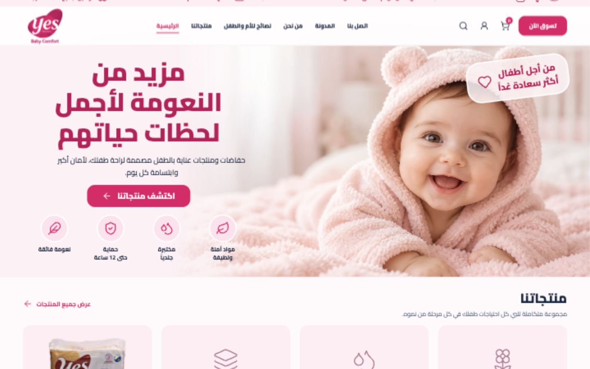
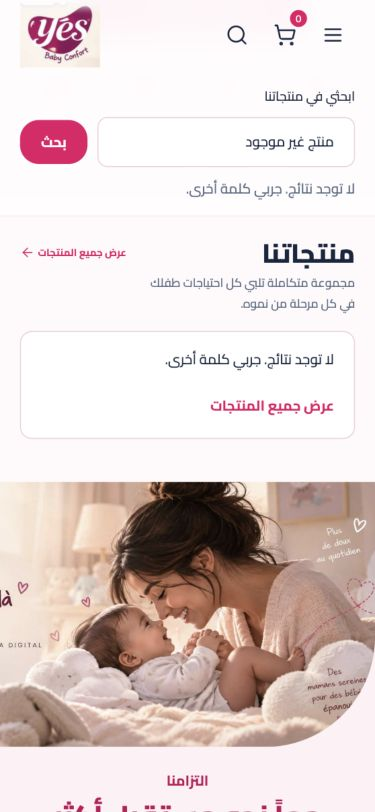
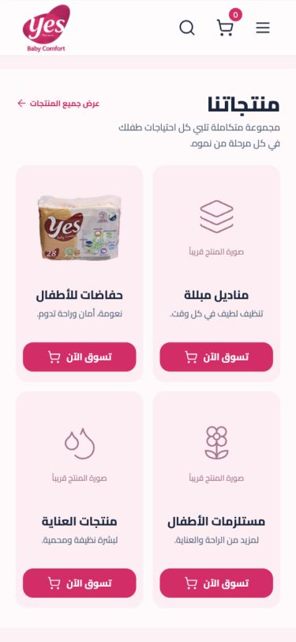
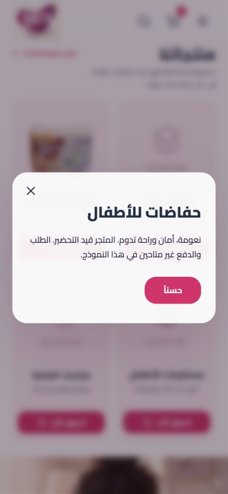
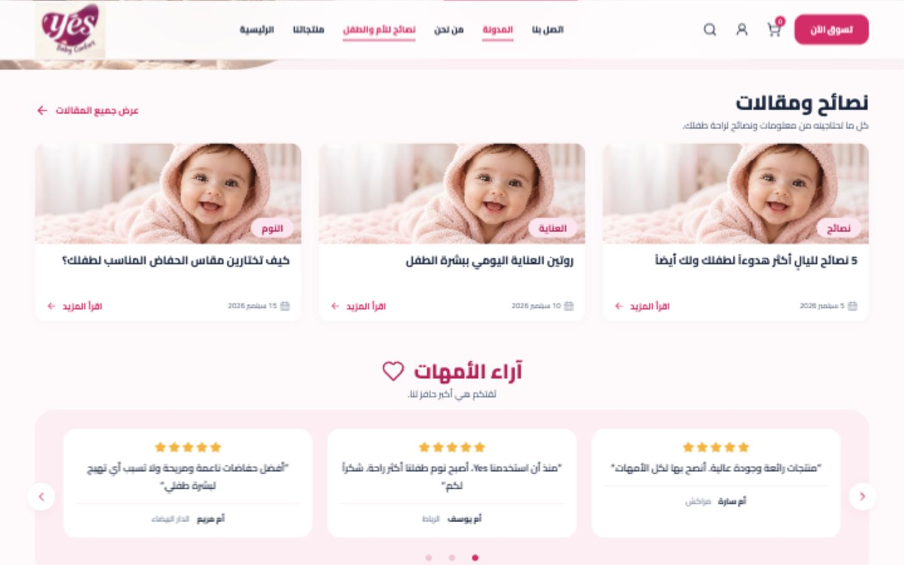
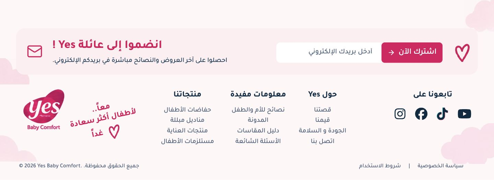

# Contrôle qualité — Yes Baby Comfort

Date : 21 octobre 2026. Surface : prototype local `http://127.0.0.1:42862/`.

**Verdict : fonctionnement du prototype validé après corrections ; publication non validée.** Les visuels, les destinations sociales et les services réels doivent encore être finalisés. Ce contrôle ne constitue pas une certification WCAG, un test de paiement ou une validation pixel perfect de toute la page.

## Parcours contrôlé

| Étape | Contrôle | Résultat |
|---|---|---|
| 1 | Accueil desktop, logo, navigation, affichage des images | Correct après harmonisation du logo |
| 2 | Recherche sans résultat puis retour à tous les produits | Défaut reproduit et corrigé ; quatre cartes réaffichées |
| 3 | Menu mobile, Échap, focus et grille produits | Correct après correction du libellé et du retour de focus |
| 4 | Fiche produit et fenêtre d’article | Ouverture, nom accessible, focus interne, fermeture Échap et retour au déclencheur vérifiés |
| 5 | Articles et carrousel avec souris/clavier | Changements d’avis et indicateur actif vérifiés ; focus conservé après remplacement des indicateurs |
| 6 | Newsletter et footer | Email incorrect rejeté ; email valide affiche le message de démonstration ; section active et ressources vérifiées |

## Défauts corrigés pendant le contrôle

- **P2 — Recherche bloquante** : après une requête sans résultat, « عرض جميع المنتجات » ne retirait pas le filtre. Un véritable reset rétablit maintenant les cartes et efface la recherche. Un état vide explicite propose le même retour.
- **P2 — Fermeture du menu au clavier** : Échap masquait le menu mais conservait le libellé « إغلاق القائمة » et perdait le focus. Le contrôle reprend maintenant son nom et le focus revient au bouton d’ouverture.
- **P2 — Fenêtres sans nom accessible** : ajout de `aria-labelledby` et `aria-describedby`. Le navigateur expose désormais le nom du produit ou de l’article comme nom du dialogue.
- **P2 — Focus des indicateurs d’avis** : la reconstruction du carrousel supprimait le bouton focalisé. Le focus est maintenant conservé après activation au clavier.
- **P2 — Contraste** : texte légal à 3,37:1, liens du footer à 4,10:1 et placeholder à 2,46:1 sur leurs fonds unis. Ces textes utilisent désormais `#586c84`, à environ 5,11:1 sur `#fff7f8` et 5,39:1 sur blanc. Dates et noms de villes des avis ont aussi été assombris.
- **P2 — Petites cibles** : boutons du header mobile et flèches à 44 px ; indicateurs du carrousel à 28 px avec disque visuel conservé ; réseaux sociaux avec zone tactile accrue.
- **P2 — Ancres sous le header** : le décalage de défilement s’adapte à la hauteur réelle du header, y compris lorsque la recherche est ouverte.
- **P2 — Section contact absente de l’indication active** : le footer est désormais suivi, avec `aria-current="location"` sur le lien correspondant. Vérifié en bas de page.
- **P2 — Logo incohérent** : le header utilisait encore l’ancien logo sur fond beige. Il utilise maintenant le même logo rose isolé que le footer.
- Icônes décoratives retirées de l’arbre accessible : 57 SVG exposés avant, aucun après. Les contrôles conservent leurs noms.
- Menu et recherche s’excluent mutuellement pour éviter leur superposition.
- Repli ajouté lorsque `IntersectionObserver` est absent ; contenu visible et interactions disponibles.

## Performance

- Les deux grandes photos sont servies en WebP, sans changement de cadrage ni de dimensions : environ **3,4 Mo → 300 Ko**, soit une réduction d’environ **91 %** des octets de ces deux images.
- Les quatre icônes sociales sont conservées en SVG statiques issus de Font Awesome. La bibliothèque de rendu n’est plus téléchargée au runtime : JavaScript de production d’environ **114 Ko → 22 Ko** (environ 6,9 Ko gzip).
- Les originaux PNG restent archivés dans les ressources. Ces chiffres portent sur les fichiers utilisés par la page, pas sur la taille totale du dossier.
- Aucun score Lighthouse ni mesure de réseau mobile réel n’a été produit.

## Responsive

Mesures DOM réalisées dans le navigateur pendant cette session :

| Largeur | Débordement horizontal | Colonnes produits | Colonnes footer |
|---|---|---:|---:|
| 320 px | Aucun | 2 | 2 |
| 375 px | Aucun | 2 | 2 |
| 768 px | Aucun | 2 | 4 |
| 1024 px | Aucun | 4 | 5 |
| 1440 px | Aucun | 4 | 5 |

Captures visuelles inspectées à 375 et 1440 px. Aux autres largeurs, contrôle de géométrie et de grilles ; aucune validation exhaustive de tous les états à chaque largeur.

## Points restant avant publication

- **P1 — Trois packshots manquants** : lingettes, soins et accessoires sont encore remplacés par des placeholders explicites (étape 3). Le pack de couches disponible diffère de celui de la maquette.
- **P1 — Visuels éditoriaux provisoires** : les trois articles utilisent le même bébé ; la photo d’engagement provient d’un visuel de campagne avec du texte français visible (étapes 2 et 5). Fournir les photos définitives.
- **P1 — Services réels absents** : newsletter, compte, panier et achat restent des démonstrations ; un email valide ne crée aucune inscription et un bouton produit ne permet aucune commande (étapes 4 et 6).
- **P2 — Réseaux sociaux** : les liens Instagram, Facebook, TikTok et YouTube pointent encore vers `#contact` ; les URL officielles restent à renseigner (étape 6 et inspection DOM).
- **P2 — Contenus définitifs** : articles, FAQ, politique de confidentialité et conditions d’utilisation restent des extraits ou messages de démonstration. Les avis sont signalés comme exemples.
- La fidélité pixel perfect globale demeure non validée, notamment à cause des images provisoires.

## Vérifications techniques et limites

- Build final de production : réussi.
- Tests existants de service statique/packaging : **4 réussis sur 4**.
- Aucune erreur console sur la version finale inspectée ; aucune image cassée constatée.
- Apparitions : quatre cartes contrôlées avec opacité finale 1 et classe `is-visible` ; navigation et défilement revus visuellement.
- États hover/focus et réduction des mouvements revus dans le CSS/JavaScript. La préférence système de réduction des mouvements n’a pas été modifiée pour un essai réel.
- Tests clavier ciblés effectués ; aucun essai avec lecteur d’écran, Safari/Firefox, appareil tactile physique ou zoom système.
- Contrastes calculés sur les couleurs CSS unies ; pas de certification de contraste sur toutes les photos et tous les états.

## Captures du contrôle

Les images ci-dessous ont été capturées dans cette session, sauvegardées et inspectées. Les captures intermédiaires 2, 4 et 5 précèdent l’harmonisation finale du logo du header. Une première capture des produits pendant leur animation a été rejetée puis remplacée par l’état stabilisé.

### 1. Accueil desktop — correct après harmonisation du logo

### 2. Recherche vide — récupération corrigée

### 3. Produits mobile — mise en page correcte, ressources provisoires visibles

### 4. Fenêtre produit — clavier et nom accessible vérifiés

### 5. Articles et avis — interactions correctes, photographies à finaliser

### 6. Newsletter/footer — structure et contrôles vérifiés, services en démonstration

