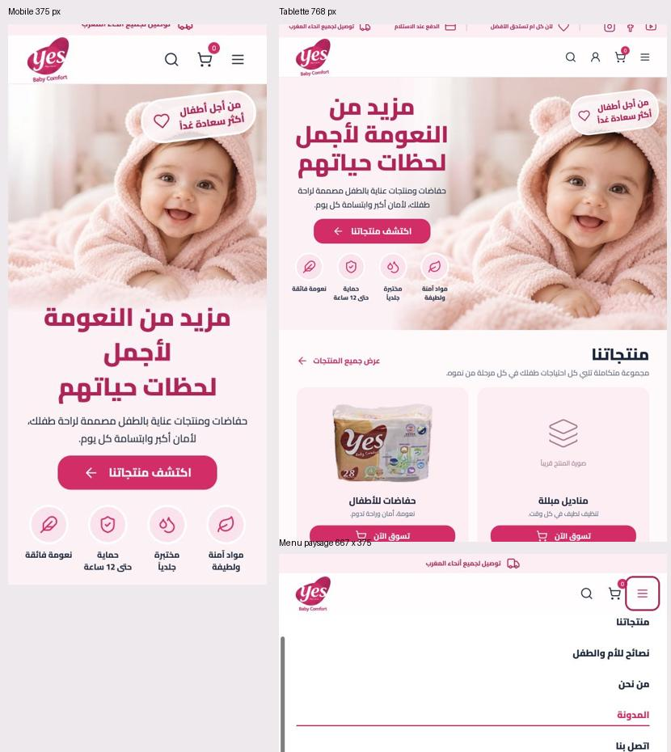

# Contrôle responsive — 21 octobre 2026

**Résultat : corrections appliquées et vérifiées.** Contrôle dans le navigateur intégré sur 12 largeurs : 320, 375, 430, 600, 767, 768, 820, 1023, 1024, 1280, 1440 et 1920 px. Test supplémentaire en paysage à 667 × 375.

## Défauts confirmés et corrigés

1. **Footer à 320 px : logo et slogan coupés.** Le logo commençait à x=-16 px et le slogan atteignait x=345 px. La page ne débordait pas car son conteneur masquait ces parties. Dimensions et espacement deviennent fluides ; après correction, le bloc tient entre x=29 et x=299 px. Les colonnes restent équilibrées et les titres sont adaptés sous 360 px.
2. **Menu paysage trop haut.** Le menu descendait jusqu’à environ 460 px dans une fenêtre de 375 px. Sa hauteur est maintenant limitée à l’espace disponible et il défile indépendamment. Mesures finales : bas du menu à 375 px, dernier lien à 355 px après défilement interne.
3. **État du menu après redimensionnement.** Le passage au desktop referme le menu mobile et rétablit ses attributs ; le retour en mobile ne réouvre pas un ancien état.
4. **Champs trop petits sur certains formats.** Recherche et newsletter ont une taille de police d’au moins 16 px sur mobile ; même minimum pour la newsletter au petit breakpoint desktop 1024 px. Cela vise notamment à limiter le zoom de mise au point sur mobile ; non testé sur un iPhone physique.
5. **Confort tactile.** Boutons produits et liens d’articles mobiles à 44 px minimum de hauteur ; descriptions produits à 12 px et fenêtres défilantes dans les écrans courts.
6. **Formats intermédiaires.** Footer sur deux colonnes jusqu’à 767 px ; hero plus compact en paysage court.

## Vérifications

- Aucun débordement horizontal sur les 12 largeurs.
- Aucun débordement mesuré du contenu du hero ou du bloc d’engagement lors du contrôle initial.
- Aucun logo/slogan coupé sur les 12 largeurs après correction.
- Produits : 2 colonnes jusqu’à 1023 px, 4 à partir de 1024 px.
- Articles : 1 colonne jusqu’à 767 px, 3 à partir de 768 px.
- Captures inspectées : accueil mobile à 375 px, tablette à 768 px, région du footer à 320 px, menu paysage à 667 × 375.
- Menu paysage : défilement jusqu’au dernier lien vérifié.
- Passage menu ouvert → desktop : `aria-expanded=false` et libellé d’ouverture rétabli.
- Build de production final réussi ; aucune erreur console constatée durant le contrôle.

Les mesures détaillées sont dans `qa/responsive/measurements.json`.

## Captures

Les captures complètes du footer comportent un recouvrement de capture par le header sticky ; elles ne sont pas utilisées pour juger le contenu sous le header. La comparaison ci-dessus utilise la région logo/slogan non recouverte des mêmes captures.

## Limites

Simulation de dimensions dans le navigateur intégré. Pas de validation sur appareils physiques, Safari iOS ou clavier virtuel réel. La présence de visuels provisoires demeure indépendante du responsive. Aucun changement de structure ou de proportions du footer desktop de référence.
